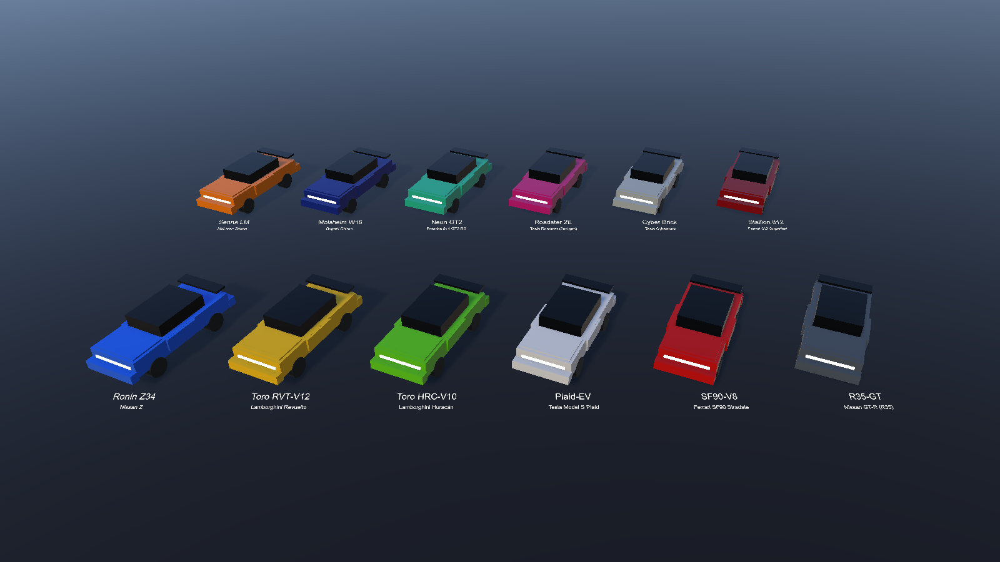
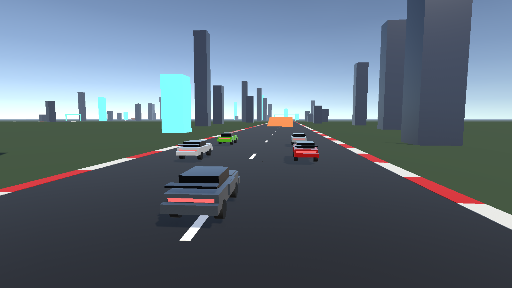
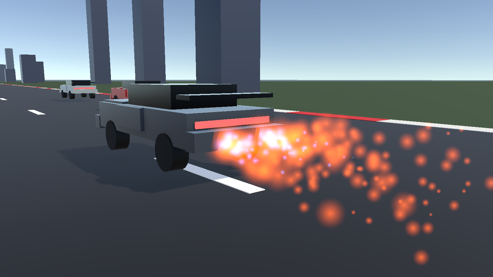
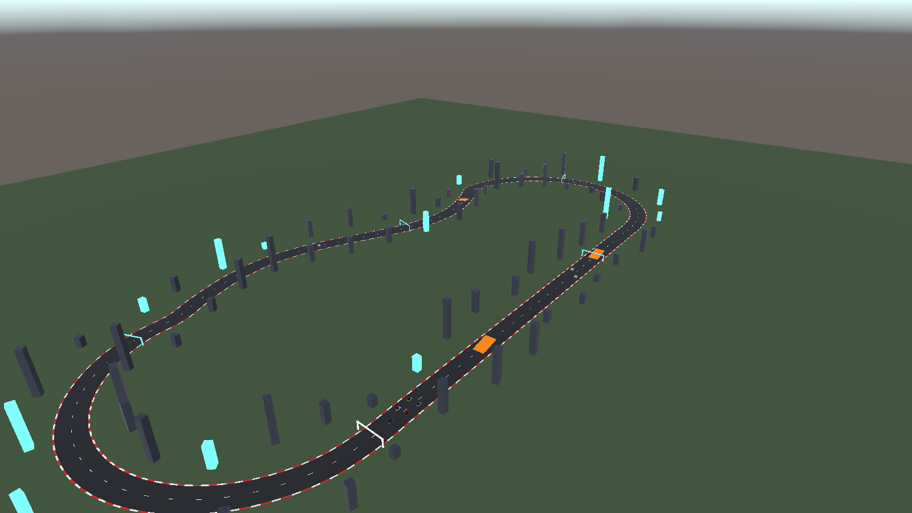

# Car Monster

Аркадная 3D-гонка на выживание и время на Unity 6 (URP): гиперкары, чекпоинты, трамплины и контактная борьба. Тараньте соперников на нитро, выбивайте их из гонки (Knockout) и получайте за это бонусное время и заряд ускорения.



| Старт заезда | Идеальный впрыск нитро |
|---|---|
|  |  |



> Все скриншоты сняты автоматически из демо-сцены (меню **Car Monster → Capture README Screenshots**). Модели пока собраны из примитивов: это прототип геймплея, меши заменяются без правок кода.

---

## Быстрый старт

**Нужно:** Unity **6000.0.77f1** (Unity 6 LTS), установленная через Unity Hub. Код совместим и с Unity 2022.3 LTS.

1. Запусти `start-unity.bat`. Он сам найдёт нужную версию редактора в Unity Hub и откроет проект.
2. Открой сцену `Assets/_CarMonster/Scenes/Demo_TimeAttack.unity` и нажми **Play**.
3. Если сцены нет или ты хочешь пересобрать её с нуля: **Car Monster → Build Demo Scene**.

### Управление

| Действие | Клавиатура | Геймпад |
|---|---|---|
| Газ / тормоз, задний ход | `W` / `S` (или стрелки) | `RT` / `LT` |
| Руль | `A` / `D` | левый стик |
| Дрифт (удерживать с рулём) | `Space` | `X` / `RB` |
| Нитро / идеальный впрыск | `Shift` | `A` |

## Батники

| Файл | Что делает |
|---|---|
| `start-unity.bat` | Открывает проект в версии Unity из `ProjectSettings/ProjectVersion.txt` |
| `deploy.bat` | Собирает Windows x64 билд в `Builds/Windows/CarMonster.exe` и упаковывает его в `Builds/CarMonster-Windows.zip`. С ключом `deploy.bat nozip` только собирает |
| `run-tests.bat` | Прогоняет PlayMode-тесты геймплея, результат пишет в `Logs/test-results.xml` |

Редактор ищется по пути `%ProgramFiles%\Unity\Hub\Editor\<версия>\Editor\Unity.exe`. Другой путь задаётся переменной окружения `UNITY_EXE`. Перед `deploy.bat` и `run-tests.bat` закрой проект в редакторе: batchmode не открывает проект, который уже открыт.

---

## Ростер машин

Все характеристики лежат в ScriptableObject `CarDataSO` (`Assets/_CarMonster/Data/Cars`) и правятся прямо в инспекторе. Чтобы сгенерировать или обновить ассеты, выбери **Car Monster → Create Car Roster**.

| Шасси | Прототип | Класс | Макс. км/ч | Масса, кг | HP | Фишка |
|---|---|---|---|---|---|---|
| **R35-GT** | Nissan GT-R (R35) | Drift | 325 | 1750 | 110 | Полный привод, агрессивный дрифт, нитро копится ×1.35 |
| **SF90-V8** | Ferrari SF90 Stradale | Track | 350 | 1570 | 90 | Лучшая максималка и руль на скорости |
| **Plaid-EV** | Tesla Model S Plaid | Heavy | 322 | 2160 | 140 | Мгновенный старт, таран ×1.5 |
| **Toro HRC-V10** | Lamborghini Huracán | Drift | 325 | 1420 | 85 | Самый вертлявый дрифт |
| **Toro RVT-V12** | Lamborghini Revuelto | Hyper | 350 | 1770 | 105 | Гибридная тяга на всех скоростях |
| **Ronin Z34** | Nissan Z | Drift | 275 | 1570 | 80 | Медленный, но король набора нитро (×1.6) |
| **Stallion 812** | Ferrari 812 Superfast | Muscle | 340 | 1630 | 100 | Стабильный GT на длинных дугах |
| **Cyber Brick** | Tesla Cybertruck | Heavy | 215 | 3100 | 220 | Стальной утюг: таран ×2, броня 45% |
| **Roadster 2E** | Tesla Roadster (2nd gen) | Hyper | 345 | 1900 | 95 | Самый быстрый разгон в игре |
| **Neun GT2** | Porsche 911 GT2 RS | Track | 340 | 1470 | 90 | Точный руль и устойчивость |
| **Molsheim W16** | Bugatti Chiron | Hyper | 380 | 1995 | 125 | Король максималки, поворачивает как танкер |
| **Senna LM** | McLaren Senna | Track | 335 | 1200 | 75 | Максимум сцепления, самая хрупкая |

> **Про названия.** В игре используются кодовые имена шасси, а реальная модель указана только в поле `inspiredBy` для дизайнеров. Названия, логотипы и узнаваемый дизайн реальных марок — товарные знаки, и для публичного релиза под ними нужна лицензия производителя. Для личной сборки `displayName` можно переименовать в инспекторе как угодно: код к названиям не привязан.

---

## Архитектура

```
Assets/_CarMonster/
├─ Scripts/                      сборка CarMonster.Gameplay
│  ├─ Core/      CarDataSO, GameBalanceSO, ArcadeCarController, CarInputSource, PlayerCarInput, RigidbodyCompat
│  ├─ Boost/     NitroSystem
│  ├─ Combat/    TakedownSystem, DetachablePart, TimeScaleController
│  ├─ AI/        RacerAI
│  ├─ Track/     WaypointCircuit, Checkpoint, TimeAttackManager
│  ├─ Camera/    CameraSpeedController
│  └─ UI/        RaceDebugHUD
├─ Editor/                       генератор ростера, сборщик демо-сцены, билд и скриншоты
├─ Tests/PlayMode/               интеграционные тесты геймплея
└─ Data/         GameBalance.asset + Cars/*.asset
```

Машина = `ArcadeCarController` + `NitroSystem` + `TakedownSystem` + источник ввода. Ввод абстрагирован через `CarInputSource`, поэтому игрок (`PlayerCarInput`) и бот (`RacerAI`) управляют одной и той же физикой, у ИИ нет читов. Системы общаются через C#-события (`Landed`, `BoostStarted`, `AnyTakedown`, `TimeBonusAdded`…) и не держат жёстких ссылок друг на друга.

### Этап 1. Аркадная физика (`ArcadeCarController`)
- Rigidbody и raycast-подвеска на 4 колеса (пружина и демпфер нормированы на массу), без `WheelCollider`.
- Газ идёт по кривой ускорения из `CarDataSO`. Для электрокаров есть `launchBoost` — дополнительная тяга на низкой скорости.
- Руль задаёт целевую угловую скорость рыскания, которая плавно сужается к максималке. Поэтому на 350+ км/ч машина отзывчива и не срывается в штопор.
- Сцепление экспоненциально гасит боковую скорость. В дрифте сцепление падает, а «потерянная» боковая скорость перетекает в продольную, так что занос не убивает темп.
- Дрифт: держи кнопку с рулём. Руль в сторону заноса закручивает дугу, руль против заноса её расширяет.
- В воздухе: дополнительная гравитация, выравнивание корпуса по нормали будущего места приземления (луч вниз) и подруливание рысканием. При приземлении корпус доворачивается к дороге, а отскок гасится.
- Если машина лежит на крыше дольше 2 секунд, она автоматически переворачивается.

### Этап 2. Нитро (`NitroSystem`)
- Шкала из 3 уровней, ёмкость уровня задаётся в шасси.
- Нажатие тратит один уровень и даёт буст. Пока буст идёт, по шкале впрыска бежит курсор.
- **Идеальный впрыск:** повторное нажатие в зелёной зоне даёт рывок, усиленный буст и огненный шлейф. Идеальные впрыски подряд складываются в цепочку до 3 штук. Нажатие *раньше* зелёной зоны срывает впрыск, и до конца цикла perfect уже не получить (защита от спама).
- Заряд начисляется за секунды в дрифте, время в воздухе (от 0.45 с), пролёты впритирку (соперник вошёл в радиус и вышел без касания на относительной скорости 50+ км/ч) и тейкдауны.
- Пролёты впритирку ищутся через `OverlapSphereNonAlloc` и массивы фиксированного размера, в кадре нет аллокаций.

### Этап 3. Бой и разрушения (`TakedownSystem`)
Каждая машина сама решает, атаковала ли она в момент удара:

```
урон = скорость_сближения(км/ч) × damagePerKmh × ramPower
       × (масса_атакующего / масса_жертвы)^massInfluence
       × бонус_за_удар_в_борт × фронтальность
       × нитро (×1.8, при идеальном впрыске ×2.3)
       × (нет нитро и сближение < 85 км/ч ? 0.12 : 1)
       × (1 − броня_жертвы)
```

- Сильный удар отрывает одну деталь. Когда HP кончается, наступает **Knockout**: отстреливаются все `DetachablePart` (бампера, капот, спойлер, двери получают собственный Rigidbody), летят искры и взрыв, включается хитстоп и **слоу-мо на 0.8 с**. Атакующий получает уровень нитро, игрок — **+5 секунд**.
- `TimeScaleController` — единственный владелец `Time.timeScale`. Он масштабирует `fixedDeltaTime`, поэтому физика в слоу-мо остаётся плавной.
- Детали не уничтожаются: при респавне они возвращаются на место без Instantiate/Destroy.

### Этап 4. Трасса, таймер, ИИ
- `WaypointCircuit` — замкнутый маршрут со сглаживанием Catmull-Rom. Он вычисляет точку и направление по пройденной дистанции, а также прогресс машины вдоль трассы.
- `RacerAI` целится в точку впереди по трассе (дистанция упреждения растёт со скоростью) и сбрасывает скорость по кривизне впереди. В крутых поворотах он дрифтит. Препятствия объезжает по трём лучам, при этом дорогу и трамплины игнорирует (пологие нормали). На прямых жмёт нитро и с вероятностью, зависящей от `skill`, ловит идеальный впрыск. По характеру (`aggression`) таранит игрока, если тот впереди, и перекрывает ему линию, если тот сзади. Если застрял, сдаёт назад.
- `TimeAttackManager`: отсчёт 3-2-1, таймер, бонусы за чекпоинты, круги и тейкдауны. Разбитые и упавшие с трассы машины через 3 секунды возвращаются на трассу, на свободное место по маршруту, и получают 2 секунды неуязвимости.

### Этап 5. Камера (`CameraSpeedController`)
- FOV растёт с квадратом скорости, добавляется на нитро и идеальном впрыске.
- Тряска через Cinemachine Impulse при ударах и жёстких приземлениях.
- Во время слоу-мо тейкдауна включается отдельная камера с фокусом на разбитой машине.
- Поддерживаются Cinemachine 3 (Unity 6) и Cinemachine 2 (2022.3) через версионные дефайны в asmdef. Без Cinemachine скрипт работает с обычной `Camera`.

---

## Баланс

- **Пер-машинные параметры** (двигатель, руль, дрифт, подвеска, полёт, масса, таран, HP, нитро) задаются в `CarDataSO`.
- **Глобальные параметры** задаются в `Data/GameBalance.asset`, сгруппированные по секциям:
  - `nitro`: длительность буста, зелёная зона, источники заряда;
  - `combat`: формула урона, бонус времени, длительность слоу-мо;
  - `timeAttack`: стартовое время, бонус за чекпоинт, количество кругов, задержка респавна;
  - `ai`: упреждение, скорость в поворотах, лучи объезда;
  - `cameraFx`: FOV и сила тряски.

## Как поставить свою модель машины

1. Создай пустой корень с Rigidbody. Меш кузова и его коллайдеры положи дочерними объектами.
2. Расставь 4 пустых `WheelAnchor` внутри коллайдера корпуса на уровне ступиц. Меши колёс положи в отдельные pivot-объекты.
3. Добавь компоненты `PlayerCarInput` (или `RacerAI`), `ArcadeCarController`, `NitroSystem`, `TakedownSystem` и назначь `CarDataSO` и `GameBalance`.
4. Детали, которые должны отлетать, вынеси отдельными объектами с коллайдером и компонентом `DetachablePart`.
5. Образец со всеми FX можно посмотреть в машинах, которые генерирует `CarFactory`.

## Тесты

`run-tests.bat` запускает PlayMode-тесты на реальной демо-сцене:
- разгон игрока и движение всех ботов по трассе;
- идеальный впрыск в зелёной зоне и срыв впрыска при раннем нажатии;
- нитро-таран в борт: Knockout, отлёт деталей, слоу-мо, +5 секунд и респавн через 3 секунды с полным ремонтом.

## Что дальше

- Нормальные модели и материалы вместо примитивов.
- Игровой HUD на UI Toolkit. Сейчас `RaceDebugHUD` на IMGUI, он только для отладки.
- Экран выбора машины по `CarDataSO`.
- Звук двигателя, удара и нитро.
- Пост-обработка скорости (motion blur, хроматическая аберрация) через URP Volume.
