# Car Monster

Аркадная 3D-гонка на выживание и время на Unity 6 (URP). В игре 27 гиперкаров и бронемашин, три локации со своей музыкой и контактная борьба. Тараньте соперников на нитро или ковшом бронемашины, выбивайте их из гонки (Knockout), получайте бонусное время и зарабатывайте кредиты на новые машины.

Разбить можно любую машину, включая вашу. Через 3 секунды обломки слетаются обратно, и машина сама едет дальше.

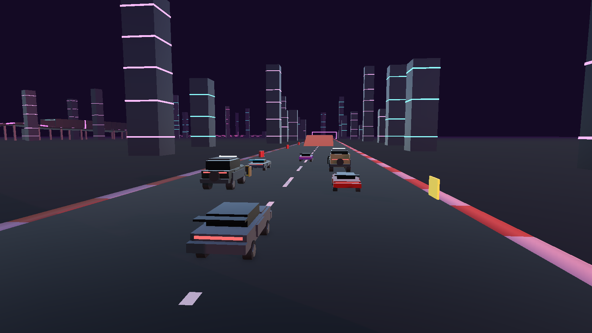

| Desert Canyon | Arctic Port |
|---|---|
| 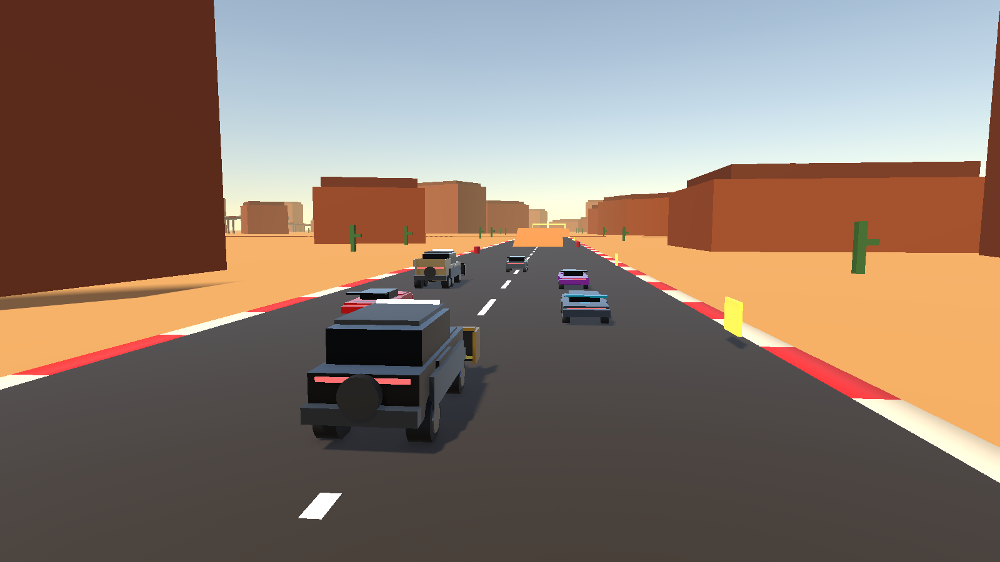 | 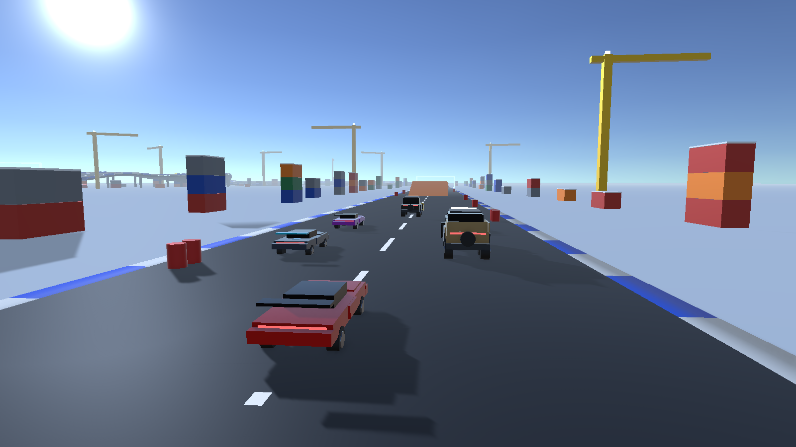 |

> Все скриншоты сняты автоматически из сцен проекта (меню **Car Monster → Capture README Screenshots**). Модели пока собраны из примитивов: это прототип геймплея, меши заменяются без правок кода.

---

## Быстрый старт

**Нужно:** Unity **6000.0.77f1** (Unity 6 LTS), установленная через Unity Hub. Код совместим и с Unity 2022.3 LTS.

1. Запусти `start-unity.bat`. Он сам найдёт нужную версию редактора и откроет проект.
2. Открой сцену `Assets/_CarMonster/Scenes/Loc_NeonCity.unity` и нажми **Play**: откроется гараж.
3. Если нужно пересобрать всё с нуля (машины, префабы, локации, сцены), выбери **Car Monster → Build Location Scenes**.

Готовая сборка для Windows делается через `deploy.bat`.

### Управление

| Действие | Клавиатура | Геймпад |
|---|---|---|
| Газ / тормоз, задний ход | `W` / `S` (или стрелки) | `RT` / `LT` |
| Руль | `A` / `D` | левый стик |
| Дрифт (удерживать с рулём) | `Space` | `X` / `RB` |
| Нитро / идеальный впрыск | `Shift` | `A` |
| Пауза | `Esc` | `Start` |
| Рестарт (на паузе и на результатах) | `R` | `Select` |
| Полный экран / окно | `F11` или `Alt+Enter` | — |

**В гараже:** `←` / `→` листают машины, `↑` / `↓` переключают локацию, `Enter` запускает гонку или покупает машину, `M` (или зелёная кнопка) — **+1 000 000 CR**.

## Батники

| Файл | Что делает |
|---|---|
| `start-unity.bat` | Открывает проект в версии Unity из `ProjectSettings/ProjectVersion.txt` |
| `deploy.bat` | Собирает Windows x64 билд со всеми локациями в `Builds/Windows/CarMonster.exe` и упаковывает его в `Builds/CarMonster-Windows.zip` (`deploy.bat nozip` — только сборка) |
| `run-tests.bat` | Прогоняет PlayMode-тесты геймплея, результат пишет в `Logs/test-results.xml` |

Редактор ищется по пути `%ProgramFiles%\Unity\Hub\Editor\<версия>\Editor\Unity.exe`. Другой путь задаётся переменной окружения `UNITY_EXE`. Перед `deploy.bat` и `run-tests.bat` закрой проект в редакторе.

---

## Гараж и экономика

При запуске игра открывает гараж прямо на стартовой решётке. Камера показывает выбранную машину, рядом — её характеристики, цена и описание.

- Бесплатно доступны **R35-GT**, **Ronin Z34** и **Cyber Brick**. На старте у игрока **20 000 CR**.
- Кредиты начисляются за каждый заезд:
  - 500 за чекпоинт;
  - 3 000 за тейкдаун;
  - 8 000 за финиш;
  - 100 за каждую оставшуюся секунду;
  - 1 000 утешительных, если время вышло.
- Кредиты и купленные машины сохраняются в PlayerPrefs.
- Все суммы настраиваются в `GameBalance.asset` → `economy`.
- **Кнопка «куча бабок»:** в гараже зелёная кнопка или клавиша `M` сразу дают +1 000 000 CR. Сумма задаётся в `economy.moneyCheatAmount`. Перед релизом кнопку можно выключить флагом `economy.showMoneyCheat`.
- В редакторе есть отладочные пункты: **Car Monster → Debug → Add 100 000 Credits** и **Reset Progress**.

После финиша открывается экран результатов: время, чекпоинты, тейкдауны и заработанные кредиты.

## Аварии и самосборка

| Разбита | Собирается сама |
|---|---|
| 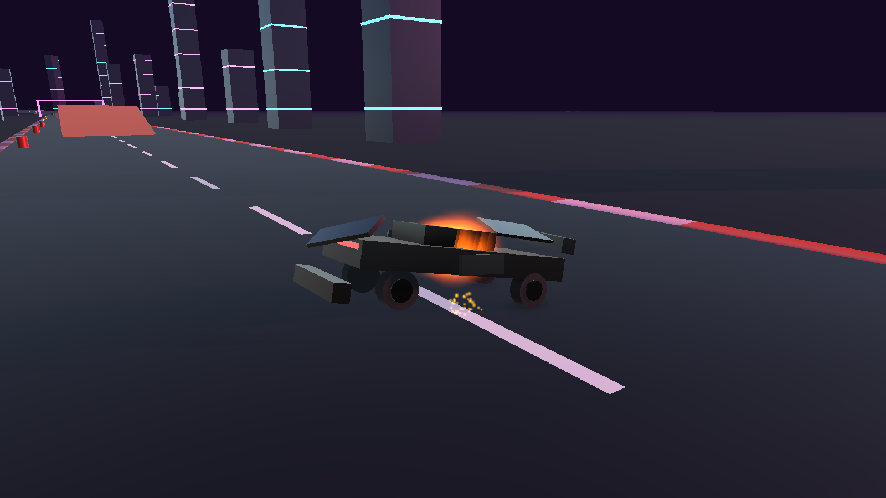 | 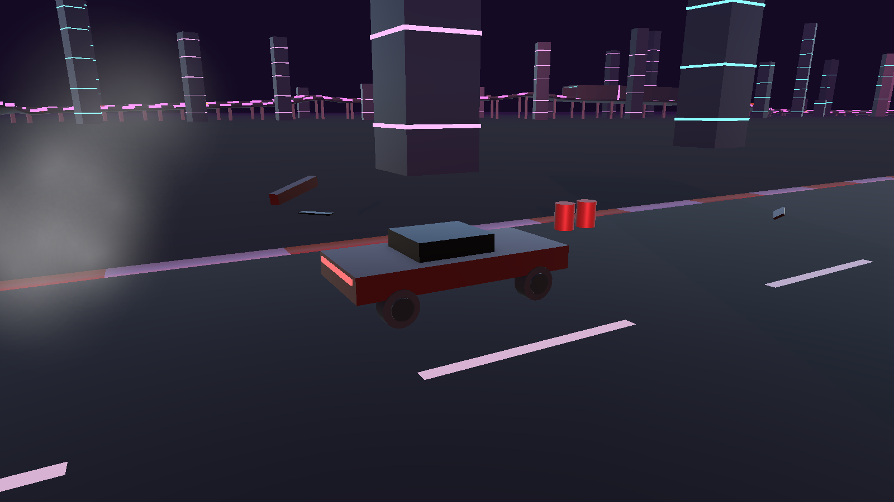 |

> Эти два кадра сняты прямо из игры PlayMode-тестом `Screenshot_Tour`.

- **Уничтожить можно любую машину, включая вашу:**
  - тараном соперника (на нитро, на скорости или ковшом бронемашины);
  - лобовым ударом в стену, отбойник или бетонный блок. Порог — от 100 км/ч по нормали к поверхности, урон 1 HP за 1 км/ч.
- **Разбитая машина** обугливается и горит, детали кузова разлетаются. Слоу-мо включается, только если в аварии участвуете вы.
- **Через 3 секунды машина собирается сама:**
  - корпус по дуге взлетает к точке на трассе на 6 м впереди места аварии, пропасти пропускаются;
  - обломки по очереди слетаются на свои места с вращением и искрами;
  - цвет «отгорает» из чёрного обратно в родной;
  - HP восстанавливается полностью, и машина **продолжает гонку с разгона 90 км/ч**.
- Пока машина собирается, она «призрак»: не толкает других и не получает урона. После сборки ещё 2 секунды неуязвимости.
- Если место впереди занято машиной, стеной или блоком, точка сборки сдвигается дальше по трассе.
- **Вылет с трассы** (с эстакады, в пропасть, в поле дальше 12 м от дороги дольше 2.5 с) тоже заканчивается самосборкой на трассе.
- Все тайминги настраиваются в `GameBalance.asset` → `combat` (Wall crash, Self-reassembly) и `timeAttack`.

## Ростер — 27 машин

Все характеристики лежат в ScriptableObject `CarDataSO` (`Assets/_CarMonster/Data/Cars`) и правятся прямо в инспекторе. Префабы находятся в `Assets/_CarMonster/Prefabs/Cars`. Перегенерировать всё можно через **Car Monster → Create Car Roster**.

### Street и Race

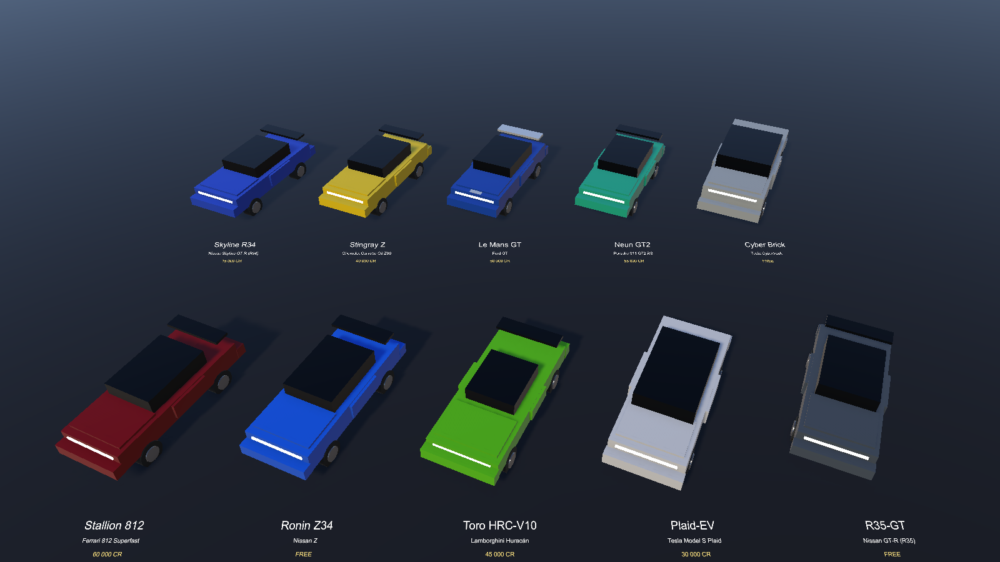

| Машина | Прототип | Мотор | км/ч | Цена | Фишка |
|---|---|---|---|---|---|
| **R35-GT** | Nissan GT-R (R35) | V6 битурбо | 325 | бесплатно | Полный привод, агрессивный дрифт, нитро ×1.35 |
| **Ronin Z34** | Nissan Z | V6 турбо | 275 | бесплатно | Король набора нитро (×1.6) |
| **Cyber Brick** | Tesla Cybertruck | электро | 215 | бесплатно | Стальной утюг: таран ×2, броня 45% |
| **Skyline R34** | Nissan Skyline GT-R (R34) | I6 турбо | 290 | 15 000 | Самый длинный занос в игре |
| **Plaid-EV** | Tesla Model S Plaid | электро | 322 | 30 000 | Мгновенный старт, таран ×1.5 |
| **Stingray Z** | Chevrolet Corvette C8 Z06 | V8 | 315 | 40 000 | Громкий плоский V8, дёшево и злобно |
| **Toro HRC-V10** | Lamborghini Huracán | V10 | 325 | 45 000 | Самый вертлявый дрифт |
| **Le Mans GT** | Ford GT | V6 битурбо | 348 | 50 000 | Ровный и цепкий |
| **Neun GT2** | Porsche 911 GT2 RS | оппозитная шестёрка | 340 | 55 000 | Точный руль на скорости |
| **Stallion 812** | Ferrari 812 Superfast | V12 | 340 | 60 000 | Стабильный GT на длинных дугах |

### Hyper

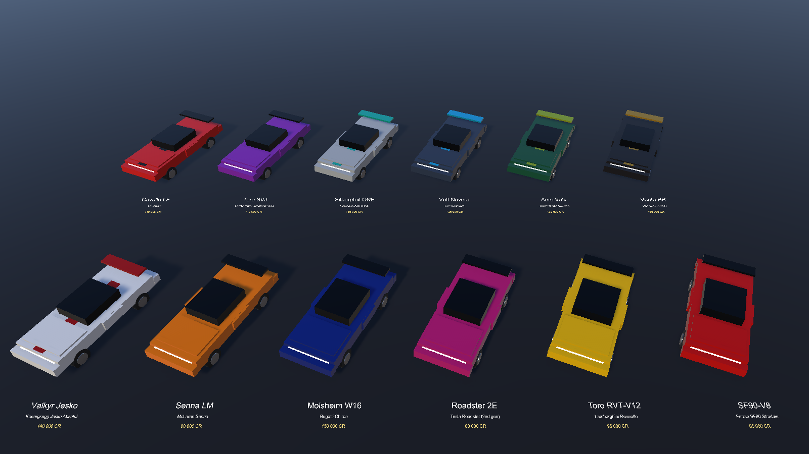

| Машина | Прототип | Мотор | км/ч | Цена | Фишка |
|---|---|---|---|---|---|
| **Roadster 2E** | Tesla Roadster (2nd gen) | электро | 345 | 80 000 | Самый доступный гиперкар с электро-стартом |
| **SF90-V8** | Ferrari SF90 Stradale | V8 гибрид | 350 | 85 000 | Лучший руль на максималке |
| **Senna LM** | McLaren Senna | V8 битурбо | 335 | 90 000 | Максимум сцепления, хрупкая |
| **Toro RVT-V12** | Lamborghini Revuelto | V12 гибрид | 350 | 95 000 | Тяга на всех скоростях |
| **Toro SVJ** | Lamborghini Aventador SVJ | V12 | 350 | 110 000 | Красиво ходит боком на 300 |
| **Cavallo LF** | LaFerrari | V12 гибрид | 350 | 115 000 | Электро-подхват снизу, вой V12 сверху |
| **Vento HR** | Pagani Huayra R | V12 | 355 | 120 000 | Лучший руль, весит 1050 кг |
| **Volt Nevera** | Rimac Nevera | 4 электромотора | 355 | 125 000 | Старт как из пушки, тяжёлый таран |
| **Aero Valk** | Aston Martin Valkyrie | V12 11 000 об/мин | 350 | 130 000 | Прижим как у болида |
| **Silberpfeil ONE** | Mercedes-AMG ONE | V6 от Ф1 | 352 | 135 000 | Истошный визг мотора |
| **Valkyr Jesko** | Koenigsegg Jesko Absolut | V8 битурбо, 9 передач | 370 | 140 000 | Почти самая быстрая |
| **Molsheim W16** | Bugatti Chiron | W16 квадротурбо | 380 | 150 000 | Король максималки |

### Armored Special — бронемашины с ковшом

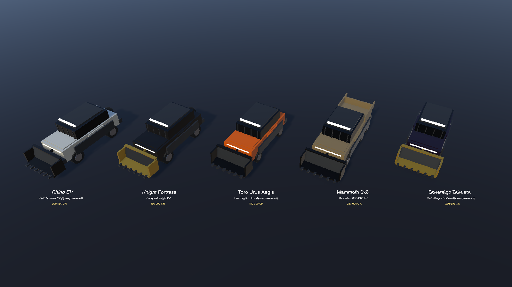

Дорогой спецкласс: тяжёлые бронированные внедорожники с ковшом спереди.

- **Ковш:**
  - удар лбом всегда засчитывается как боевой (даже без нитро и на малой скорости);
  - урон умножается на ×1.5–2.0;
  - жертву отбрасывает в сторону.
- **Фронтальная броня:** если бьют в ковш, урон снижается на 50–75%.
- **Расходные детали:** бронепластины на бортах, багажник на крыше и запаска отлетают при тейкдауне.

| Машина | Прототип | Масса | HP | Ковш (урон / броня лба) | Цена |
|---|---|---|---|---|---|
| **Toro Urus Aegis** | Lamborghini Urus (бронированный) | 2900 | 200 | ×1.5 / 50% | 180 000 |
| **Rhino EV** | GMC Hummer EV (бронированный) | 4100 | 280 | ×1.7 / 60% | 200 000 |
| **Mammoth 6x6** | Mercedes-AMG G63 6x6 | 4000 | 300 | ×1.8 / 65% | 220 000 |
| **Sovereign Bulwark** | Rolls-Royce Cullinan (бронированный) | 3300 | 260 | ×1.7 / 60% | 250 000 |
| **Knight Fortress** | Conquest Knight XV | 5200 | 380 | ×2.0 / 75% | 300 000 |

> **Про названия.** В игре используются кодовые имена, а реальная модель указана только в поле `inspiredBy` для дизайнеров. Названия, логотипы и узнаваемый дизайн реальных марок — товарные знаки, и для публичного релиза под ними нужна лицензия. Для личной сборки `displayName` переименовывается в инспекторе.

---

## Локации и музыка

| Локация | Трасса | Музыка |
|---|---|---|
| **Neon City** | Неоновый тоннель, эстакада над городом, 3 гребня-трамплина, виражи 12° | Synthwave, 116 BPM, ля минор |
| **Desert Canyon** | **Прыжок через пропасть** на стартовой прямой, мост над ущельем, горбатые дюны с 4 гребнями | Phonk, 130 BPM: 808-бас и ковбелл |
| **Arctic Port** | Крутые виражи 20°, две S-связки среди контейнеров, эстакада над доками | Techno, 128 BPM, ре минор |

### Что есть на картах

| Пропасть (Desert Canyon) | Неоновый тоннель (Neon City) |
|---|---|
| 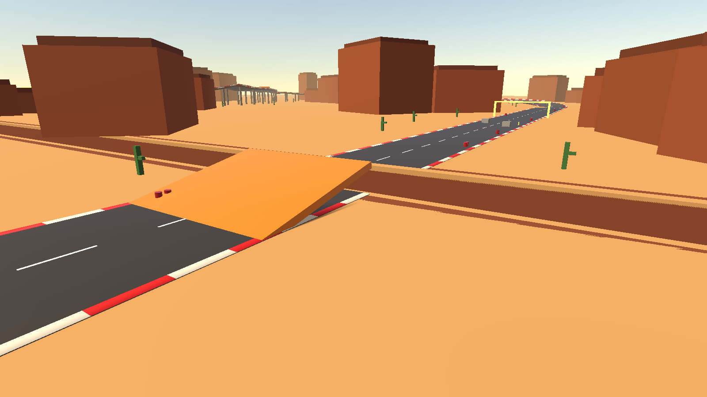 | 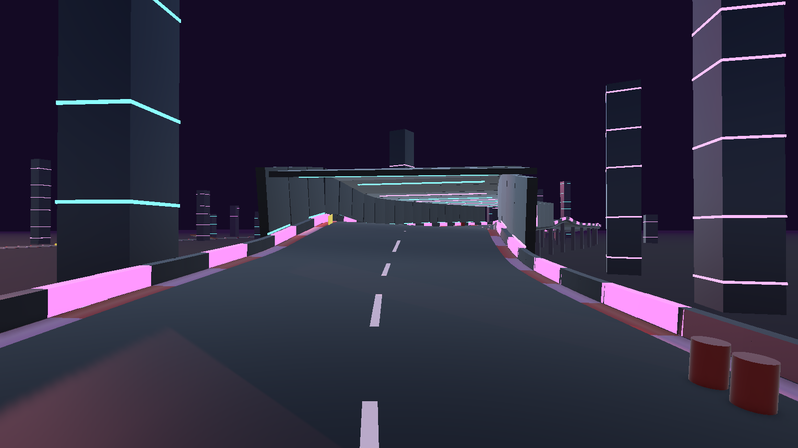 |

| Эстакада с виражом (Arctic Port) | Каньон сверху |
|---|---|
| 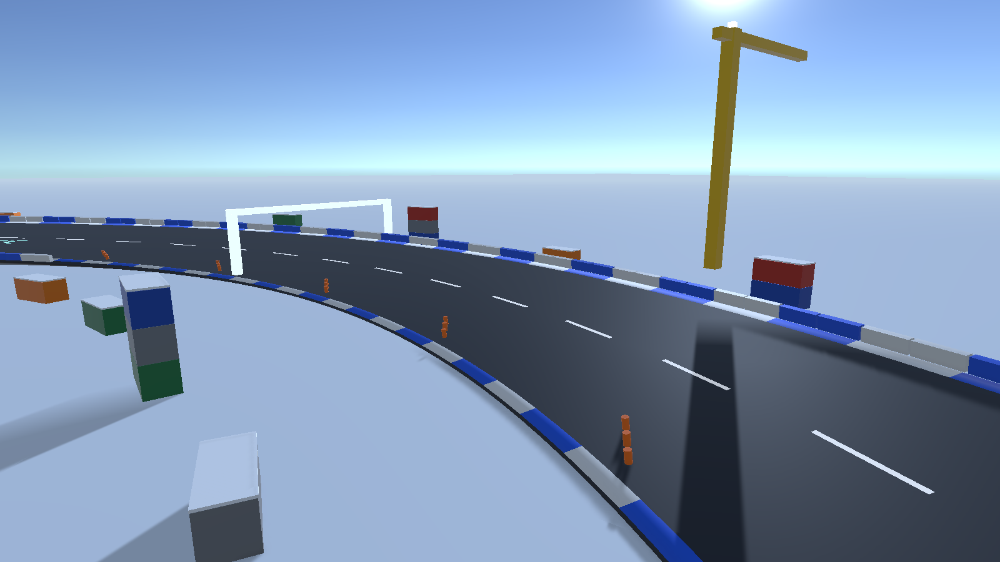 | 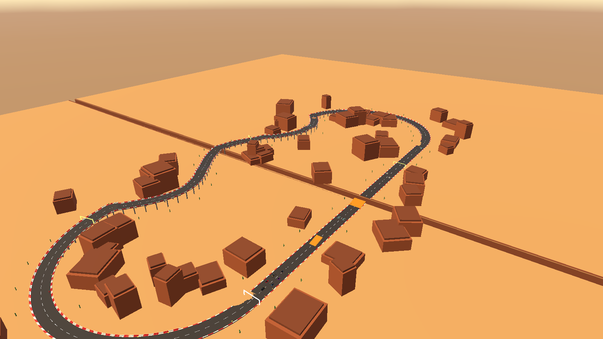 |

- **Настоящая дорога с физикой.** Это меш с MeshCollider, сгенерированный по сплайну, а не плоская подложка. У дороги есть рельеф, а **виражи** наклоняют полотно в поворотах.
- **Эстакады и гребни.** Обратная половина трассы поднимается холмом на 9–18 м на опорах. На ней горбы-гребни, с которых машина взлетает.
- **Пропасть.** На стартовой прямой каньона дорога обрывается: трамплин на всю ширину, а перед ним ускоряющие пады. Не долетел — машина падает и собирается за пропастью. Обратная прямая проходит по мосту над тем же ущельем.
- **Отбойники** стоят по внешней стороне поворотов и по обоим краям эстакад. Об них можно разбиться.
- **Ускоряющие пады** (голубые шевроны) дают рывок и немного нитро, работают и для ботов.
- **Реквизит.** Конусы в апексах поворотов, бочки и знаки у обочин разлетаются от удара и сами возвращаются на место.
- **Неоновый тоннель** в Neon City: стены — тоже препятствие.
- Плюс трамплины, бетонные блоки, которые ИИ объезжает, и декор: башни, столовые горы, контейнеры и краны.

| Neon City сверху | Arctic Port сверху |
|---|---|
| 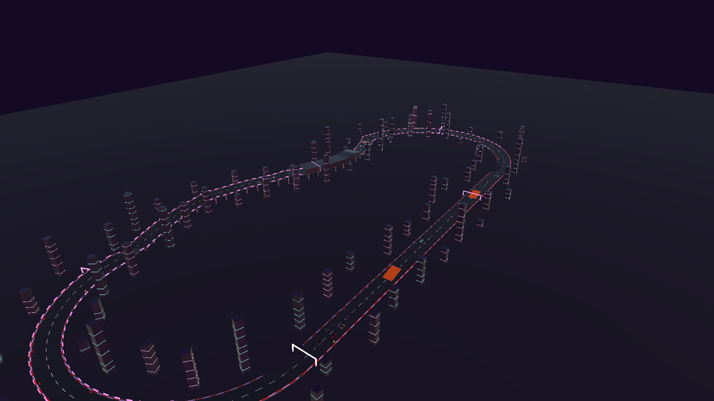 | 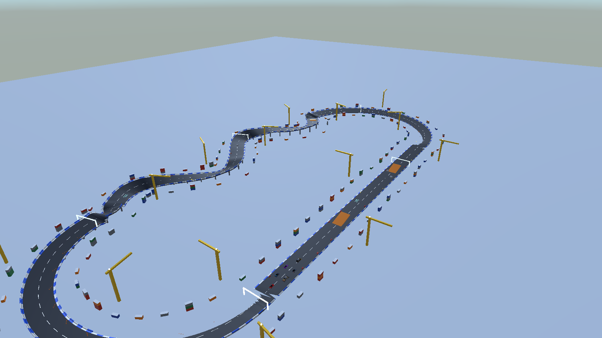 |

- **Музыка генерируется процедурно** (`ProceduralMusic`) в фоновом потоке при загрузке локации. Это петля на 32 такта со своими секциями: интро, основная часть, брейк, кульминация. Синтезаторы: бочка, 808, клэп, хэты, бас, пэды, арпеджио, ковбелл, стэбы.
- **Свои треки:** закинь mp3/ogg в `LocationSO → musicClips`, и вместо процедурного трека заиграет твой плейлист.
- **Во время слоу-мо** музыка «плывёт»: питч опускается и включается фильтр низких частот.
- Палитра, форма трассы, небо и туман каждой локации задаются в `LocationSO` (`Assets/_CarMonster/Data/Locations`).

## Звук двигателя

`EngineAudio` синтезирует звук мотора в реальном времени, без сэмплов.

- **Обороты** считаются из скорости через виртуальную коробку: передачи переключаются вверх и вниз, на месте можно перегазовать, в воздухе и в дрифте мотор раскручивается.
- **Тембр** складывается из гармоник частоты вспышек цилиндров. Количество цилиндров берётся из типа мотора: I4, I6, оппозитная шестёрка, V6, V8, V10, V12, W16. Сверху добавляются неровность работы (бубнёж V8), шум впуска и выхлопа и свист турбины.
- **Выстрелы в выхлоп** звучат при сбросе газа на высоких оборотах и при переключениях.
- **Электрокары** воют электромотором и инвертором.
- **Визг шин** в заносе и **шипение нитро**.
- **Звук ботов** трёхмерный, с допплером.
- **В слоу-мо** весь звук опускается по высоте.

Профиль звука каждой машины задаётся в `CarDataSO → Engine Sound`: тип мотора, холостые обороты, отсечка, число передач, яркость, неровность, турбо, выстрелы, высота и громкость.

---

## Архитектура

```
Assets/_CarMonster/
├─ Scripts/                      сборка CarMonster.Gameplay
│  ├─ Core/      CarDataSO, GameBalanceSO, GameCatalogSO, RaceSession (+PlayerProfile, RaceRewards),
│  │             ArcadeCarController, CarInputSource, PlayerCarInput, RigidbodyCompat
│  ├─ Audio/     EngineAudio, ProceduralMusic, MusicPlayer
│  ├─ Boost/     NitroSystem
│  ├─ Combat/    TakedownSystem (+ковш), DetachablePart, TimeScaleController
│  ├─ AI/        RacerAI
│  ├─ Track/     LocationSO, WaypointCircuit, Checkpoint, TimeAttackManager
│  ├─ Camera/    CameraSpeedController
│  └─ UI/        RaceSetupMenu (гараж/пауза/результаты), RaceDebugHUD, MenuInput, DisplaySettings
├─ Editor/       ростер машин, локации, фабрика машин, сборщик сцен, билд и скриншоты
├─ Tests/PlayMode/
├─ Prefabs/Cars/ 27 префабов
├─ Scenes/       Loc_NeonCity, Loc_DesertCanyon, Loc_ArcticPort
└─ Data/         GameBalance, GameCatalog, Cars/*, Locations/*
```

**Префаб машины** состоит из `ArcadeCarController`, `NitroSystem`, `TakedownSystem`, `EngineAudio` и `AudioSource`. Источник ввода в префаб не входит. При спавне `TimeAttackManager` добавляет `PlayerCarInput` игроку или `RacerAI` боту: обе машины управляют одной и той же физикой, у ИИ нет читов.

**Поток заезда:** гараж (`Setup`) → `BeginRace()` спавнит ботов из каталога → отсчёт 3-2-1 → гонка → финиш или конец времени → начисление кредитов → экран результатов.

### Ключевые системы

- **Физика** (`ArcadeCarController`):
  - raycast-подвеска на любое число колёс (у 6x6 их шесть);
  - отзывчивый руль на 350+ км/ч;
  - управляемый дрифт без потери темпа;
  - стабилизация в воздухе и выравнивание при приземлении;
  - автопереворот, если машина легла на крышу.
- **Нитро** (`NitroSystem`):
  - 3 уровня шкалы;
  - **идеальный впрыск** в зелёной зоне — рывок и огненный шлейф, а нажатие раньше зоны срывает впрыск;
  - заряд копится за дрифт, прыжки, пролёты впритирку и тейкдауны.
- **Бой** (`TakedownSystem`):
  - урон считается от скорости сближения, соотношения масс, угла удара, нитро и ковша минус броня;
  - **Knockout:** детали отлетают, включается хитстоп и слоу-мо на 0.8 с, игрок получает +5 с, атакующий — уровень нитро;
  - через 3 секунды машина респавнится на трассе.
- **ИИ** (`RacerAI`):
  - едет по сплайну и тормозит перед поворотами, дрифтит в крутых;
  - объезжает препятствия лучами;
  - жмёт нитро на прямых и ловит идеальный впрыск;
  - таранит и подрезает игрока;
  - бронемашины-боты всегда максимально агрессивны.
- **Камера** (`CameraSpeedController`):
  - FOV растёт со скоростью и на нитро;
  - тряска через Cinemachine Impulse;
  - на тейкдауне отдельная камера показывает разбитую машину.

```
урон = скорость_сближения(км/ч) × damagePerKmh × ramPower
       × (масса_атакующего / масса_жертвы)^massInfluence
       × бонус_за_удар_в_борт × фронтальность
       × нитро (×1.8, при идеальном впрыске ×2.3) × ковш (×1.5–2.0)
       × (удар слабый ? 0.12 : 1)
       × (1 − броня_жертвы) × (удар в ковш жертвы ? 1 − броня_ковша : 1)
```

## Баланс

- **Машины:** параметры каждой машины лежат в `CarDataSO`.
- **Глобальные параметры:** `Data/GameBalance.asset`, по секциям:
  - `nitro`;
  - `combat`;
  - `timeAttack`;
  - `ai`;
  - `cameraFx`;
  - `audio`: громкость музыки и моторов, эффект слоу-мо;
  - `economy`: кредиты.

## Как поставить свою модель машины

1. Открой префаб из `Prefabs/Cars` и замени кубы на свои меши. Компоненты трогать не нужно.
2. `WheelAnchor_*` должны остаться внутри коллайдера корпуса на уровне ступиц. Меши колёс лежат в `WheelVisual_*`.
3. Детали, которые должны отлетать, — отдельные объекты с коллайдером и `DetachablePart`.
4. Для бронемашины ковш (`RamPlow`) — обычные коллайдеры спереди. Механику включает галочка `hasRamPlow` в `CarDataSO`.

## Тесты

`run-tests.bat` запускает 11 тестов на реальных сценах:

- разгон, прыжок с трамплина без потери скорости, движение ботов по трассе и переключение передач в звуке мотора;
- идеальный впрыск и срыв впрыска при раннем нажатии;
- нитро-таран: Knockout, слоу-мо, +5 секунд, самосборка;
- краш игрока в стену: уничтожение, анимация самосборки, все детали на месте, гонка продолжается с разгона;
- ускоряющий пад даёт рывок и нитро;
- пропасть в Desert Canyon перепрыгивается без падения;
- ковш бронемашины выбивает соперника без нитро;
- ковш поглощает фронтальный удар (20 урона против 50 в борт);
- гараж: смена машины (6x6 с ковшом) и старт гонки с 6 машинами;
- все три локации загружаются и генерируют свой трек;
- расчёт наград.

## Что дальше

- Нормальные модели и материалы вместо примитивов.
- UI на UI Toolkit вместо IMGUI-прототипа.
- Звуки ударов и взрывов.
- Пост-обработка скорости через URP Volume.
- Таблица рекордов по локациям.
